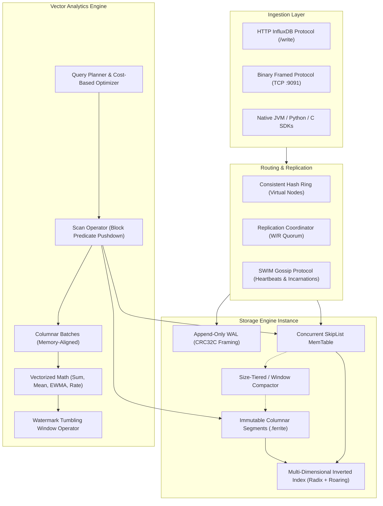
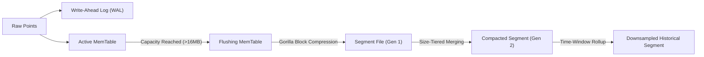
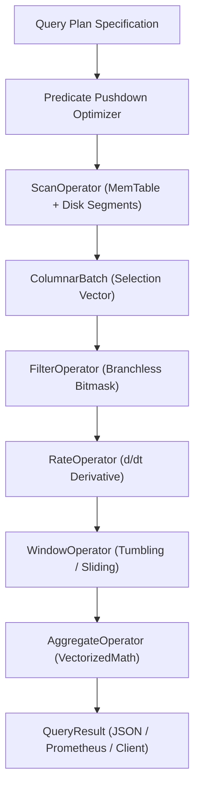

# Ferrite System Architecture

Ferrite is a high-performance distributed time-series engine and columnar analytics runtime written in Apache Groovy 4 on the Java Virtual Machine. It combines Facebook Gorilla XOR compression, an append-only write-ahead log (WAL), concurrent skiplist memory tables, immutable columnar segment files, vectorized query execution, and a SWIM-inspired decentralized gossip protocol.

---

## 1. End-to-End Architectural Overview

---

## 2. Ingestion Pipeline

When telemetry data enters Ferrite through either the HTTP endpoint or the binary TCP reactor:

1. **Framing & Zero-Copy Parsing**:
   - InfluxDB Line Protocol payloads are parsed by `LineProtocolParser`, which performs unescaped delimiter tokenization and converts timestamps (nanoseconds or milliseconds) into epoch milliseconds.
   - Binary frames are unpacked by `BinaryFrameCodec` using a 20-byte fixed header layout and verified using hardware-accelerated CRC32C table lookups.

2. **Durable Logging (WAL)**:
   - Points are framed into `WALEntry` structures with monotonic 64-bit sequence numbers.
   - The entry is appended to an active segment log file with an automatic CRC32C trailer to ensure atomic recovery following unexpected termination.

3. **In-Memory Buffering (MemTable)**:
   - Data is stored in a `ConcurrentSkipListMap` partitioned by `TimeSeriesKey`.
   - Each series maintains chronological order with $O(\log N)$ point lookups and lock-free thread safety.

4. **Multi-Dimensional Indexing**:
   - `InvertedIndex` extracts all metric name components and label tuples (`key=value`).
   - Roaring-style compressed bitmaps and radix prefix trees index the series IDs, enabling sub-millisecond tag-intersection queries.

---

## 3. Storage Hierarchy & Immutability

- **Active MemTable**: Accepts writes concurrently while serving real-time raw reads.
- **Flushing MemTable**: Marked read-only during background disk serialization. Reader-writer lock protects concurrent writes from ever attempting to insert into a read-only table.
- **Segment Files (`.ferrite`)**: Immutable columnar files containing binary headers, series dictionary, Gorilla-compressed timestamp and floating-point blocks, and bloom filters.

---

## 4. Query Execution Engine

Ferrite implements a Volcano-style iterator model operated over columnar batches rather than row tuples.

### Key Execution Optimizations:
1. **Block Pushdown**: Time range boundaries and Bloom filter tests evaluate entire segment blocks before any decompression occurs.
2. **Selection Vectors**: Rather than copying vector elements during filtering, operators maintain an `int[]` selection vector of valid row indices.
3. **Hardware-Friendly Vector Math**: Computations on primitive arrays operate in tight, branch-free loops suitable for JIT autovectorization.
