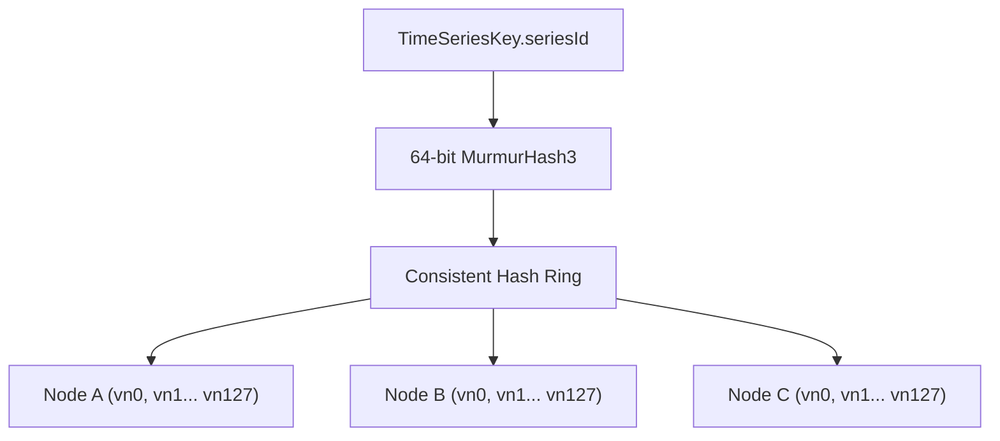
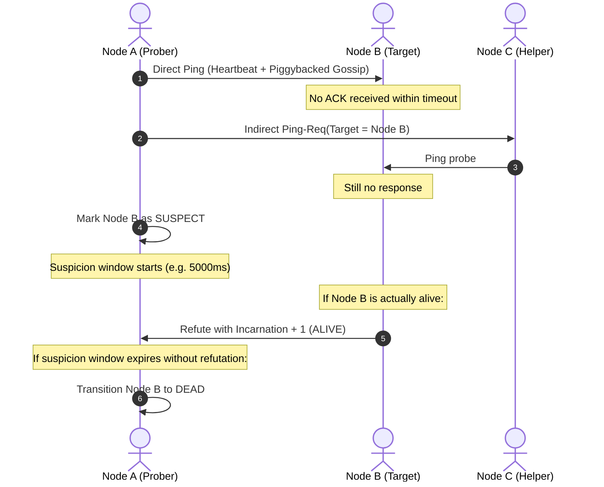

# Ferrite Cluster Consensus & Replication Specification

Ferrite employs a decentralized, masterless architecture inspired by Dynamo and the SWIM gossip protocol. All nodes are peers capable of coordinating writes, executing queries, and participating in cluster membership.

---

## 1. Consistent Hash Ring with Virtual Nodes

To avoid hotspots and achieve uniform key distribution, the hash ring uses a 64-bit circular token space $[0, 2^{64}-1]$ generated via MurmurHash3.

- **Virtual Nodes (vnodes)**: Each physical node is allocated 128 virtual node tokens across the ring. Adding or removing a physical machine rebalances only $1/N$ of total keyspace data.
- **Preference Lists**: For any key hash, the coordinator traverses the ring clockwise using binary search (`ceilingKey`), collecting the first $N$ unique physical nodes (skipping duplicate vnodes) to form the replication set.

---

## 2. Distributed Vector Clocks

To track causality across replicas without relying on synchronized wall-clock times, Ferrite tags mutated versions with a `VectorClock`.

### Causal Ordering Rules:
Given two clocks $V_A$ and $V_B$:
1. **$V_A$ Happens Before $V_B$ ($V_A < V_B$)**: For all nodes $k$, $V_A[k] \le V_B[k]$ and there exists at least one node $j$ where $V_A[j] < V_B[j]$.
2. **$V_A$ Happens After $V_B$ ($V_A > V_B$)**: Symmetric to happens before.
3. **$V_A$ Equals $V_B$ ($V_A == V_B$)**: For all nodes $k$, $V_A[k] == V_B[k]$.
4. **$V_A$ Concurrent With $V_B$ ($V_A \parallel V_B$)**: There exists a node $i$ where $V_A[i] > V_B[i]$ and another node $j$ where $V_A[j] < V_B[j]$.

When concurrency is detected, Ferrite resolves conflicts using latest timestamp ordering or triggers read-repair.

---

## 3. SWIM-Inspired Gossip Membership & Failure Detection

Ferrite maintains decentralized cluster state via a SWIM gossip implementation:

### Incarnation Counter Mechanics:
- Every node maintains a monotonically increasing local incarnation number.
- Higher incarnation numbers supersede lower incarnation numbers across all states.
- If a healthy node discovers that peers are gossiping a `SUSPECT` or `DEAD` state regarding itself, it increments its local incarnation number and broadcasts an authoritative `ALIVE` update, immediately quashing false accusations caused by transient network partitions.

---

## 4. Tunable Quorum Replication & Read-Repair

Ferrite supports tunable consistency levels:

$$R + W > N$$

Where $N$ is the replication factor, $W$ is the write quorum count, and $R$ is the read quorum count.

| Consistency Level | Required Acknowledgements ($N=3$) | Guarantee |
|:------------------|:-----------------------------------|:----------|
| **ONE**           | 1 node                             | Lowest latency, risk of stale reads |
| **QUORUM**        | $\lfloor N/2 \rfloor + 1 = 2$ nodes| Strong consistency ($R+W > N$)      |
| **ALL**           | 3 nodes                            | Highest consistency, unavailable on single node failure |

### Read-Repair:
When a query executes under `QUORUM` consistency, the coordinator compares responses returned by responding replicas. If one replica returns a stale timestamp or missing point compared to the authoritative version, the coordinator asynchronously dispatches the fresh data back to the lagging replica in the background.

---

## 5. Merkle Tree Anti-Entropy

To reconcile historical partitions without transferring entire datasets, nodes construct a binary `MerkleTree` over fixed time intervals:
- Each leaf represents a uniform time partition bucket.
- Metric points are hashed into leaf buckets using MurmurHash3.
- Parent nodes recursively hash child node hashes.
- Two nodes exchange only the root hash ($O(1)$ transfer). If root hashes match, replicas are guaranteed identical. If root hashes differ, nodes traverse down the tree to isolate the exact diverging sub-intervals in $O(\log N)$ network steps.
